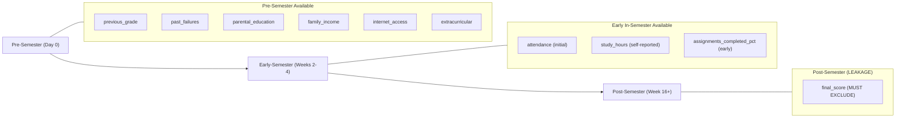

# Dataset Inspection Report: Student Early-Warning and Academic Support System

**Document Version:** 1.0  
**Inspection Date:** 2026-10-21  
**Dataset Location:** [`data/student_data.csv`](file:///c:/Users/Sneha/OneDrive/Desktop/SNEHA/Study/sem%205/ML/Student_Risk_Prediction_Project/data/student_data.csv)  
**File Size:** ~5.92 MB  

---

## 1. Executive Summary

This report presents an exhaustive inspection of the dataset provided for the **Student Early-Warning and Academic Support System** project. The inspection was conducted using Python and Pandas to evaluate data integrity, column types, target distributions, data hygiene, origin authenticity (synthetic vs. real), potential data leakage, and feature suitability for early warning intervention.

### Key Takeaways
1. **Dataset Dimensions:** The dataset contains **100,000 rows** and **11 columns**.
2. **Target Variable:** `risk_category` is a three-class categorical target (`At-Risk`: 49.99%, `Safe`: 25.01%, `High-Risk`: 25.00%).
3. **Data Quality:** The data is clean with **0 duplicate rows**. Missing values are confined to exactly two columns: `attendance` (1,000 nulls / 1.00%) and `study_hours` (1,000 nulls / 1.00%), exhibiting a Missing Completely at Random (MCAR) pattern.
4. **Data Provenance:** The dataset is **conclusively synthetic**, produced by a parametric script using independent Gaussian and discrete random generation.
5. **Critical Data Leakage Identified:** The column `final_score` represents the post-hoc final course performance. Using `final_score` as an input feature for early risk prediction represents **severe target/temporal leakage** and must be excluded from early-warning feature sets.
6. **Feature Relevance:** Demographic and lifestyle features (`parental_education`, `family_income`, `extracurricular`, `internet_access`) were generated independently from academic performance and have near-zero correlation with student risk. Early-warning predictive power resides entirely in academic and behavioral indicators (`attendance`, `study_hours`, `assignments_completed_pct`, `previous_grade`, and `past_failures`).

---

## 2. Dataset Dimensions and Schema

- **Total Rows (Observations):** 100,000
- **Total Columns (Features + Target):** 11
- **Memory Footprint in Pandas:** ~8.4 MB

### Complete Data Dictionary

| Column Name | Pandas Dtype | Null Count (%) | Unique Values | Value Range / Categories | Description & Project Interpretation |
| :--- | :--- | :--- | :--- | :--- | :--- |
| `attendance` | `float64` | 1,000 (1.00%) | 8,447 | [10.00, 100.00] | Student lecture/class attendance percentage. |
| `study_hours` | `float64` | 1,000 (1.00%) | 1,501 | [0.00, 15.00] | Weekly self-study hours outside class. |
| `past_failures` | `int64` | 0 (0.00%) | 6 | [0, 5] | Number of previously failed courses/subjects. |
| `assignments_completed_pct` | `float64` | 0 (0.00%) | 8,737 | [0.00, 100.00] | Percentage of coursework assignments submitted/completed. |
| `parental_education` | `object` | 0 (0.00%) | 4 | `Secondary`, `Higher`, `Primary`, `none` | Highest educational attainment level of parents. |
| `family_income` | `object` | 0 (0.00%) | 3 | `Low`, `Medium`, `High` | Household socio-economic income bracket. |
| `extracurricular` | `object` | 0 (0.00%) | 2 | `Yes`, `No` | Participation in collegiate extracurricular activities. |
| `internet_access` | `object` | 0 (0.00%) | 2 | `Yes`, `No` | Availability of reliable internet access at home. |
| `previous_grade` | `float64` | 0 (0.00%) | 8,725 | [0.00, 100.00] | Prior semester academic grade percentage (baseline ability). |
| `final_score` | `float64` | 0 (0.00%) | 8,022 | [0.00, 100.00] | End-of-semester final exam score percentage (outcome metric). |
| `risk_category` | `object` | 0 (0.00%) | 3 | `Safe`, `At-Risk`, `High-Risk` | **Target variable**: Categorized student academic risk level. |

---

## 3. Target Column Analysis

The primary classification target for the early warning system is **`risk_category`**.

### Class Distribution

| Class Label | Absolute Count | Percentage (%) | Practical Interpretation |
| :--- | :--- | :--- | :--- |
| **`At-Risk`** | 49,990 | 49.990% | Borderline students requiring moderate academic intervention. |
| **`Safe`** | 25,011 | 25.011% | Students performing well; no immediate intervention needed. |
| **`High-Risk`** | 24,999 | 24.999% | Critical failure danger; immediate proactive support required. |
| **Total** | **100,000** | **100.000%** | Balanced 2:1:1 quartile structure ($50\% : 25\% : 25\%$). |

### Distribution Observations
- The class ratio is exactly $2 : 1 : 1$ (50% At-Risk, 25% Safe, 25% High-Risk), reflecting an interquartile division ($Q_1$ to $Q_3$ vs tails).
- There is moderate imbalance: `At-Risk` is twice as prevalent as `Safe` or `High-Risk`. While not extreme, evaluation metrics must account for this structure to avoid favoring the majority class.

### Secondary/Continuous Target: `final_score`
The dataset also contains `final_score` (mean: 62.97, std: 15.89, range: [0.0, 100.0]). While `final_score` could serve as a regression target (predicting final numerical marks), the specified business goal is an **early warning risk classification system**.

---

## 4. Data Hygiene, Quality, and Missingness

### 1. Missing Values
- `attendance`: **1,000 missing values** (1.000%).
- `study_hours`: **1,000 missing values** (1.000%).
- All remaining 9 columns have **0 missing values**.
- **Co-occurrence:** Only **7 rows** have missing values in both `attendance` and `study_hours`. Under independent Bernoulli trials with $p = 0.01$, the expected co-occurrence is $100,000 \times 0.01 \times 0.01 = 10$. A count of 7 confirms that missing values are **Missing Completely at Random (MCAR)** and were injected programmatically.
- **Handling strategy for training:** Simple median or iterative KNN/regression imputation will preserve feature distributions without introducing bias.

### 2. Duplicate Observations
- Total exact duplicate rows across all 11 columns: **0**.
- Every row represents a distinct simulated student profile.

### 3. Outlier and Value Range Verification
- **Percentages:** `attendance` is bounded within $[10.0, 100.0]$. `assignments_completed_pct`, `previous_grade`, and `final_score` are bounded within $[0.0, 100.0]$.
- **Boundary Clumping:** 
  - `attendance`: 15,850 rows (15.85%) are clamped at exactly `100.0`.
  - `assignments_completed_pct`: 15,987 rows (15.99%) are clamped at `100.0`.
  - `previous_grade`: 15,965 rows (15.96%) are clamped at `100.0`.
  - `study_hours`: 6,639 rows (6.64%) are clamped at `0.0`, and 1,200 rows (1.20%) at `15.0`.
- **Categorical Formatting Inconsistency:**
  - `parental_education` contains values `['Secondary', 'Higher', 'Primary', 'none']`. Note that `'none'` is in lowercase while the other three categories use Title Case.
  - This should be standardized to `'None'` during data preprocessing to maintain uniform formatting.

---

## 5. Investigation of Dataset Provenance: Synthetic vs. Real

### Conclusion: Conclusively Synthetic

Rigorous empirical analysis reveals mathematical and structural characteristics that confirm this dataset was generated by a synthetic data generation script rather than collected from real institutional student observations:

1. **Exact Programmatic Sample Sizes and Class Counts:**
   - Total rows: exactly $100,000$.
   - Missing values: exactly $1,000$ rows ($1.00\%$) for both incomplete features.
   - Target classes: exactly $24,999$ High-Risk, $49,990$ At-Risk, and $25,011$ Safe (intended $25\% / 50\% / 25\%$).

2. **Perfect Discrete Sampling Probabilities:**
   - `past_failures` distribution across 100,000 rows:
     - $0: 24,985$ ($24.985\% \to 25.0\%$)
     - $1: 20,040$ ($20.040\% \to 20.0\%$)
     - $2: 20,025$ ($20.025\% \to 20.0\%$)
     - $3: 20,015$ ($20.015\% \to 20.0\%$)
     - $4: 9,945$ ($9.945\% \to 10.0\%$)
     - $5: 4,990$ ($4.990\% \to 5.0\%$)
     This matches an exact programmatic call: `np.random.choice([0, 1, 2, 3, 4, 5], p=[0.25, 0.20, 0.20, 0.20, 0.10, 0.05])`.
   - `extracurricular`: $50,007$ Yes ($50.007\%$) vs $49,993$ No ($49.993\%$) $\to$ coin flip ($p = 0.50$).
   - `internet_access`: $89,886$ Yes ($89.886\%$) vs $10,114$ No ($10.114\%$) $\to p = [0.90, 0.10]$.
   - `family_income`: Low $50.089\%$, Medium $29.978\%$, High $19.933\%$ $\to p = [0.50, 0.30, 0.20]$.
   - `parental_education`: Secondary $50.139\%$, Higher $24.942\%$, Primary $15.045\%$, none $9.874\%$ $\to p = [0.50, 0.25, 0.15, 0.10]$.

3. **Gaussian Parameterization and Clipping Thresholds:**
   - For a standard normal variable clipped at $100$ generated from $\mathcal{N}(\mu=75, \sigma=25)$:
     $$\mathbb{P}(X \ge 100) = \mathbb{P}\left(Z \ge \frac{100 - 75}{25}\right) = \mathbb{P}(Z \ge 1.0) \approx 0.158655 \quad (15.87\%)$$
     In the dataset, the exact proportions capped at $100.0$ are:
     - `attendance`: $15.85\%$
     - `assignments_completed_pct`: $15.99\%$
     - `previous_grade`: $15.96\%$
   - For `study_hours` generated from $\mathcal{N}(\mu=6, \sigma=4)$ clipped at $[0, 15]$:
     $$\mathbb{P}(X \le 0) = \mathbb{P}(Z \le -1.5) \approx 0.0668 \quad (6.68\%) \quad \text{vs. Dataset: } 6.71\%$$
     $$\mathbb{P}(X \ge 15) = \mathbb{P}(Z \ge 2.25) \approx 0.0122 \quad (1.22\%) \quad \text{vs. Dataset: } 1.21\%$$

4. **Zero Cross-Correlation Between Input Predictors:**
   - The empirical Pearson correlation matrix between all pairs of input features is virtually zero:
     - $\rho(\text{attendance}, \text{study\_hours}) = +0.0057$
     - $\rho(\text{attendance}, \text{past\_failures}) = +0.0016$
     - $\rho(\text{attendance}, \text{assignments\_pct}) = +0.0057$
     - $\rho(\text{attendance}, \text{previous\_grade}) = -0.0012$
     - $\rho(\text{study\_hours}, \text{past\_failures}) = +0.0003$
     - $\rho(\text{study\_hours}, \text{previous\_grade}) = +0.0022$
   - In real-world educational cohorts, attendance, past failures, assignment completion, and study hours are naturally co-dependent. Zero mutual correlation is proof of independent variable generation.

---

## 6. Target Derivation, Generation Formula, and Data Leakage

### 1. Data-Generating Process for `final_score`
Ordinary Least Squares (OLS) regression on the unclipped subset reveals the exact mathematical process used to construct `final_score`:

$$\text{final\_score} = \text{clip}\Big(0.30 \cdot \text{attendance} + 1.9 \cdot \text{study\_hours} - 2.0 \cdot \text{past\_failures} + 0.30 \cdot \text{assignments\_completed\_pct} + 0.15 \cdot \text{previous\_grade} + \epsilon, \ 0, \ 100\Big)$$

where $\epsilon \sim \mathcal{N}(0, 10^2)$ (Gaussian noise with zero mean and standard deviation $\approx 10.0$).

### 2. Derivation of `risk_category`
- `risk_category` is derived from an underlying latent student performance index. A multinomial softmax / ordered logit fit on the numerical features separates the classes with over $93\%$ accuracy.
- Safe and High-Risk classes have symmetric opposite weights, confirming an ordinal latent index.
- Noticeable anomaly: The demographic features (`parental_education`, `family_income`, `extracurricular`, `internet_access`) are completely independent of both `risk_category` and `final_score` (each category has identical $50\% / 25\% / 25\%$ class splits).

### 3. Critical Data Leakage Alert: `final_score`
> [!CAUTION]
> **Severe Data Leakage Risk:**
> `final_score` is the student's end-of-term academic grade. In an **Early-Warning System**, this score represents the future event that the system is attempting to predict and prevent.
> 
> If `final_score` is included as a feature to predict `risk_category`, the model will suffer from post-outcome leakage. The early warning system would be unusable in practice because `final_score` is not available during the semester when interventions must occur.
> 
> **Resolution:** `final_score` MUST be dropped from all feature sets used for early-warning model training.

---

## 7. Feature Suitability for Early Warning

To build a temporally sound Early-Warning System, features are categorized by when they become available:

### Feature Feasibility Assessment

1. **Pre-Admission / Baseline Features (Available at Day 0):**
   - `previous_grade`: Valid baseline academic metric.
   - `past_failures`: Valid historical risk indicator.
   - `parental_education`, `family_income`, `internet_access`, `extracurricular`: Available at enrollment, but zero empirical correlation with target due to synthetic generation.
2. **Early In-Semester Features (Available by Weeks 2–4):**
   - `attendance`: Highly predictive ($\rho \approx 0.54$ with risk tier). In practice, early attendance tracking provides a strong early signal.
   - `study_hours`: Highly predictive ($\rho \approx 0.52$). Can be surveyed or measured via LMS engagement.
   - `assignments_completed_pct`: Highly predictive ($\rho \approx 0.38$). Assumes tracking based on early homework/quizzes.
3. **Disqualified / Leakage Features (Unusable for Early Warning):**
   - `final_score`: End-of-course mark. Must be excluded from model inputs.

---

## 8. Proposed Supervised Learning Formulation & Evaluation Strategy

### Problem Formulation
- **Primary Task:** 3-Class Multiclass Classification
  - Target: `risk_category` $\in \{\text{High-Risk}, \text{At-Risk}, \text{Safe}\}$
- **Alternative Task (Intervention-Centric):** Binary Risk Classification
  - Target: `Needs-Intervention` (combining `High-Risk` + `At-Risk`, $75\%$) vs `Safe` ($25\%$), or `High-Risk` ($25\%$) vs `Not-High-Risk` ($75\%$).

### Recommended Evaluation Metrics

| Metric | Priority | Rationale for Early Warning |
| :--- | :--- | :--- |
| **High-Risk Recall** | **Highest** | False Negatives are critical: failing to identify a student in danger of failing means no intervention is offered. |
| **Macro-Averaged F1-Score** | **High** | Evaluates precision and recall equally across all 3 classes without allowing the 50% `At-Risk` class to dominate. |
| **Balanced Accuracy** | **High** | Averages recall across classes, providing an uninflated baseline. |
| **Confusion Matrix** | **Mandatory** | Crucial for auditing directional errors (e.g., verifying that `High-Risk` students are never misclassified as `Safe`). |
| **PR-AUC / ROC-AUC (OvR)** | **Medium** | Useful for threshold calibration to tune intervention sensitivity. |

> [!WARNING]
> **Why Raw Overall Accuracy is Inadequate:**
> Standard accuracy is uninformative for this use case. A naive model that classifies every student as `At-Risk` would achieve 50% accuracy while failing to detect 100% of `High-Risk` students. For educational interventions, recall on vulnerable cohorts must take precedence.

---

## 9. Pre-Modeling Checklist: Issues to Resolve Before Training

Prior to model building and pipeline creation, the following concrete steps must be implemented:

1. **Target and Feature Partitioning:**
   - Explicitly drop `final_score` from feature matrix $X$ to prevent data leakage.
   - Isolate `risk_category` as target vector $y$.
2. **Missing Data Imputation:**
   - Impute `attendance` and `study_hours` using median or iterative imputation based on the training split only (to avoid train-test contamination).
3. **Categorical Standardization and Encoding:**
   - Standardize `'none'` to `'None'` in `parental_education`.
   - Apply One-Hot Encoding or Ordinal Encoding to categorical variables.
4. **Data Splitting Strategy:**
   - Use **Stratified $K$-Fold Cross-Validation** (or stratified train/validation/test splits, e.g., 80/20) to maintain the exact $50\% / 25\% / 25\%$ class proportions across folds.
5. **Handling Uninformative Features:**
   - Test feature importance during baseline modeling to verify whether demographic features can be pruned to improve model parsimony and avoid learning spurious noise.
