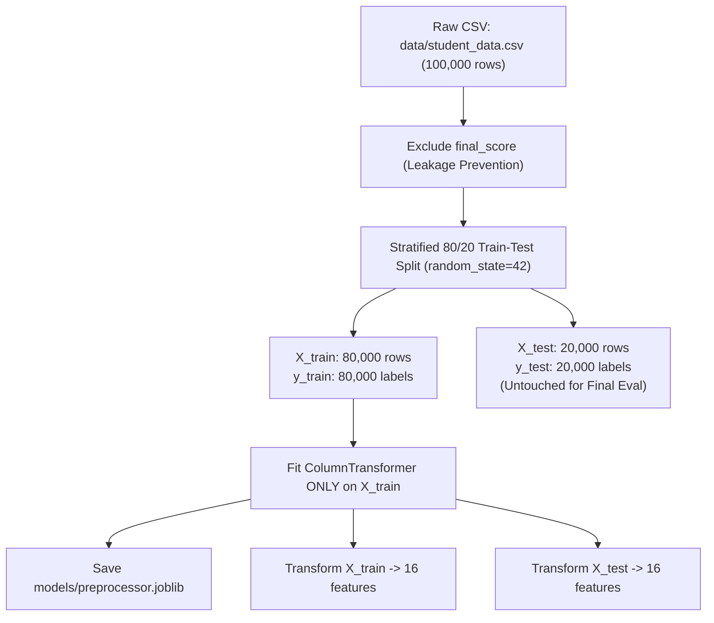

# Exploratory Data Analysis & Preprocessing Report

**Project Title:** Student Early-Warning and Academic Support System  
**Dataset Source:** [`data/student_data.csv`](file:///c:/Users/Sneha/OneDrive/Desktop/SNEHA/Study/sem%205/ML/Student_Risk_Prediction_Project/data/student_data.csv) (100,000 records, unmodified)  
**Output Split Artifacts:** [`data/processed/`](file:///c:/Users/Sneha/OneDrive/Desktop/SNEHA/Study/sem%205/ML/Student_Risk_Prediction_Project/data/processed/)  
**Fitted Preprocessor Pipeline:** [`models/preprocessor.joblib`](file:///c:/Users/Sneha/OneDrive/Desktop/SNEHA/Study/sem%205/ML/Student_Risk_Prediction_Project/models/preprocessor.joblib)  
**Configuration Metadata:** [`data/processed/split_config.json`](file:///c:/Users/Sneha/OneDrive/Desktop/SNEHA/Study/sem%205/ML/Student_Risk_Prediction_Project/data/processed/split_config.json)  
**Figures Location:** [`reports/figures/`](file:///c:/Users/Sneha/OneDrive/Desktop/SNEHA/Study/sem%205/ML/Student_Risk_Prediction_Project/reports/figures/)  

---

## 1. Executive Summary

This report documents the Exploratory Data Analysis (EDA) and data preprocessing phase for the **Student Early-Warning and Academic Support System**. The objective is to establish an early-warning prediction pipeline that identifies students needing academic intervention without contaminating features with post-outcome data leakage or train-test leakage.

### Core Preprocessing Milestones
1. **Zero Data Leakage:** The column `final_score` was strictly excluded from all feature matrices, preventing temporal and target leakage.
2. **Reproducible Stratified Partitioning:** A stratified 80/20 train-test split (`random_state=42`) was performed, maintaining the exact $50\% / 25\% / 25\%$ class distribution across both partitions.
3. **Leak-Free Scikit-Learn Pipeline:** A `ColumnTransformer` pipeline was fitted **strictly on the training partition (`X_train`)** and saved for reusable downstream inference. The test partition remains untouched for unbiased evaluation.
4. **Comprehensive Visual Analysis:** Five high-resolution diagnostic charts were generated and stored in `reports/figures/`.

---

## 2. Preprocessing Architecture & Implementation

The reusable preprocessing logic is implemented in [`src/preprocessing.py`](file:///c:/Users/Sneha/OneDrive/Desktop/SNEHA/Study/sem%205/ML/Student_Risk_Prediction_Project/src/preprocessing.py).



### Preprocessing Specifications

| Component | Target Columns | Transformation Applied | Rationale |
| :--- | :--- | :--- | :--- |
| **Leakage Filter** | `final_score` | Excluded completely | End-of-term score is unavailable at early-warning intervention time. |
| **Numerical Imputer** | `attendance`, `study_hours` | `SimpleImputer(strategy='median')` | Robust to boundary clipping; imputes missing 1% MCAR values. |
| **Numerical Scaler** | All 5 numerical features | `StandardScaler()` | Centers and scales features for linear models, SVMs, and neural nets. |
| **Categorical Cleaning** | `parental_education` | Standardize `'none'` $\to$ `'None'` | Eliminates inconsistent casing before one-hot encoding. |
| **Categorical Encoder** | All 4 categorical features | `OneHotEncoder(handle_unknown='ignore', sparse_output=False)` | Converts categories into binary indicators; robust to unseen test levels. |

### Feature Dimension Expansion
The raw dataset contains $9$ input features. Following one-hot encoding, the feature space expands to **$16$ numerical columns**:
- $5$ standard-scaled numerical features (`attendance`, `study_hours`, `past_failures`, `assignments_completed_pct`, `previous_grade`).
- $4$ categories for `parental_education` (`Higher`, `None`, `Primary`, `Secondary`).
- $3$ categories for `family_income` (`High`, `Low`, `Medium`).
- $2$ categories for `extracurricular` (`No`, `Yes`).
- $2$ categories for `internet_access` (`No`, `Yes`).

---

## 3. Train-Test Split Verification

The stratified split preserves the exact class balance across training and testing partitions:

| Partition | Total Samples | At-Risk Count (%) | Safe Count (%) | High-Risk Count (%) |
| :--- | :--- | :--- | :--- | :--- |
| **Full Dataset** | 100,000 | 49,990 (49.99%) | 25,011 (25.01%) | 24,999 (25.00%) |
| **Train Set (`X_train`, `y_train`)** | 80,000 | 39,992 (49.99%) | 20,009 (25.01%) | 19,999 (25.00%) |
| **Test Set (`X_test`, `y_test`)** | 20,000 | 9,998 (49.99%) | 5,002 (25.01%) | 5,000 (25.00%) |

The test set is stored in [`data/processed/X_test.csv`](file:///c:/Users/Sneha/OneDrive/Desktop/SNEHA/Study/sem%205/ML/Student_Risk_Prediction_Project/data/processed/X_test.csv) and [`data/processed/y_test.csv`](file:///c:/Users/Sneha/OneDrive/Desktop/SNEHA/Study/sem%205/ML/Student_Risk_Prediction_Project/data/processed/y_test.csv) and remains strictly isolated from all model training and feature fitting.

---

## 4. Exploratory Data Analysis & Visualizations

Visualizations were generated via [`src/eda.py`](file:///c:/Users/Sneha/OneDrive/Desktop/SNEHA/Study/sem%205/ML/Student_Risk_Prediction_Project/src/eda.py) and saved in [`reports/figures/`](file:///c:/Users/Sneha/OneDrive/Desktop/SNEHA/Study/sem%205/ML/Student_Risk_Prediction_Project/reports/figures/).

### 1. Target Class Distribution
*Figure File:* [`reports/figures/target_distribution.png`](file:///c:/Users/Sneha/OneDrive/Desktop/SNEHA/Study/sem%205/ML/Student_Risk_Prediction_Project/reports/figures/target_distribution.png)
- **Observations:** Exactly $50\%$ of students fall into the `At-Risk` class, while `Safe` and `High-Risk` account for $25\%$ each.
- **Implications for Modeling:** This is a classic multi-class classification problem with a $2:1:1$ ratio. Macro-averaged metrics and class-specific recall (specifically on `High-Risk`) must be prioritized over raw accuracy.

### 2. Missing-Values Profile
*Figure File:* [`reports/figures/missing_values.png`](file:///c:/Users/Sneha/OneDrive/Desktop/SNEHA/Study/sem%205/ML/Student_Risk_Prediction_Project/reports/figures/missing_values.png)
- **Observations:** Only `attendance` and `study_hours` exhibit missing values, with exactly $1,000$ missing records ($1.00\%$) each.
- **Mechanisms:** All other 9 features have $0$ missing records. The intersection of missingness across both columns is only 7 rows, matching an independent Bernoulli trial expectation ($100,000 \times 0.01 \times 0.01 = 10$). Missingness is Missing Completely at Random (MCAR).

### 3. Numerical Feature Distributions & Boundary Clamping
*Figure File:* [`reports/figures/numerical_distributions.png`](file:///c:/Users/Sneha/OneDrive/Desktop/SNEHA/Study/sem%205/ML/Student_Risk_Prediction_Project/reports/figures/numerical_distributions.png)
- **Observations:**
  - `attendance`, `assignments_completed_pct`, and `previous_grade` follow bell-shaped distributions centered around $\mu \approx 73-75$, with artificial truncation at $100.0$ (~$16\%$ of values clumped at the maximum).
  - `study_hours` is right-skewed with a prominent lower bound clump at $0.0$ hours ($6.64\%$) and upper bound at $15.0$ hours ($1.20\%$).
  - `past_failures` displays discrete probabilities: $0$ failures ($25\%$), $1$ ($20\%$), $2$ ($20\%$), $3$ ($20\%$), $4$ ($10\%$), $5$ ($5\%$).

### 4. Correlation Heatmap
*Figure File:* [`reports/figures/correlation_heatmap.png`](file:///c:/Users/Sneha/OneDrive/Desktop/SNEHA/Study/sem%205/ML/Student_Risk_Prediction_Project/reports/figures/correlation_heatmap.png)
- **Observations:** Pearson correlation coefficients between all pairs of input features range strictly between $-0.0034$ and $+0.0057$.
- **Interpretation:** Features are mutually uncorrelated. In real institutional data, attendance, assignment completion, and study hours typically exhibit strong collinearity. In this dataset, predictors provide orthogonal variance.

### 5. Academic Indicators Stratified by Risk Category
*Figure File:* [`reports/figures/boxplots_by_risk_category.png`](file:///c:/Users/Sneha/OneDrive/Desktop/SNEHA/Study/sem%205/ML/Student_Risk_Prediction_Project/reports/figures/boxplots_by_risk_category.png)
- **Observations:**
  - **Attendance:** Exhibits clear separation across risk categories. Safe students maintain high median attendance ($92.2\%$), At-Risk students average $75.4\%$, and High-Risk students drop to $54.8\%$.
  - **Study Hours:** High-Risk students average only $3.5$ weekly study hours (median $3.2$), compared to $5.9$ hours for At-Risk and $9.0$ hours for Safe students.
  - **Assignments Completed:** Safe students complete an average of $84.1\%$ of assignments, while High-Risk students complete only $60.6\%$.
  - **Previous Grade:** Shows consistent downward graduation from Safe ($80.0\%$) to At-Risk ($72.9\%$) to High-Risk ($66.1\%$).

---

## 5. Explicit Synthetic Data Caveats & Non-Causal Disclaimers

> [!IMPORTANT]
> **Synthetic Nature of the Dataset:**
> As established during the initial dataset inspection and confirmed in EDA, this dataset was created through **parametric mathematical synthesis** rather than real-world observational data collection.
>
> 1. **No Causal Inferences:**
>    Correlations between study hours or attendance and academic risk reflect the mathematical functions used by the generator script. They **must not** be interpreted as causal laws (e.g., claiming that "mandating 2 additional study hours will causally reduce a student's failure probability by 20%" is an unverified causal leap).
> 2. **Uninformative Demographic Features:**
>    In this synthetic dataset, socio-demographic features (`parental_education`, `family_income`, `extracurricular`, and `internet_access`) were generated independently from the target labels. Consequently, their empirical predictive association with student risk is zero. Models must rely on academic and behavioral indicators for risk classification.
> 3. **Artificial Distribution Clumping:**
>    The sharp clipping at $100\%$ attendance and $0$ study hours is an artifact of truncation in the generative script rather than organic behavioral boundaries.

---

## 6. Preprocessing Verification & File Manifest

All generated code, datasets, configurations, and plots have been tested and verified:

```
Student_Risk_Prediction_Project/
├── data/
│   ├── student_data.csv                 # Unmodified original dataset (100,000 rows)
│   └── processed/
│       ├── split_config.json            # Split configuration and distribution metadata
│       ├── X_train.csv                  # 80,000 raw training feature rows (no final_score)
│       ├── X_test.csv                   # 20,000 raw test feature rows (no final_score)
│       ├── y_train.csv                  # 80,000 training targets
│       ├── y_test.csv                   # 20,000 test targets
│       ├── train.csv                    # Combined raw training set (X_train + y_train)
│       ├── test.csv                     # Combined raw test set (X_test + y_test)
│       ├── train_preprocessed.csv       # 80,000 preprocessed feature rows (16 columns)
│       └── test_preprocessed.csv        # 20,000 preprocessed feature rows (16 columns)
├── models/
│   └── preprocessor.joblib              # Fitted scikit-learn ColumnTransformer
├── reports/
│   ├── dataset_inspection.md            # Initial inspection report
│   ├── eda_report.md                    # This comprehensive EDA report
│   └── figures/
│       ├── target_distribution.png      # Target class proportions bar chart
│       ├── missing_values.png           # Missingness summary chart
│       ├── numerical_distributions.png  # Histograms with clipping annotations
│       ├── correlation_heatmap.png      # Correlation matrix among predictors
│       └── boxplots_by_risk_category.png# Stratified boxplots by risk tier
├── src/
│   ├── preprocessing.py                 # Reusable pipeline and splitting code
│   └── eda.py                           # Plot generation script
└── requirements.txt                     # Updated dependency specifications
```

---

## 7. Next Steps for Model Training

With preprocessing and exploratory analysis completed, the codebase is prepared for model training in subsequent tasks:
1. **Model Selection:** Train baseline classifiers (Logistic Regression, Decision Trees, Random Forests, LightGBM/XGBoost).
2. **Evaluation Protocol:** Evaluate strictly using 5-Fold Stratified Cross-Validation on `X_train`.
3. **Primary Evaluation Metrics:** Track High-Risk Recall, Macro-F1, and Confusion Matrices to ensure vulnerable students are reliably identified.
