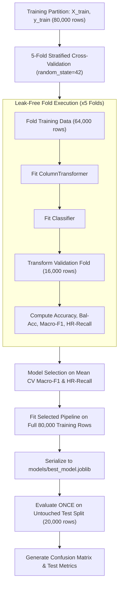

# Phase 3 Model Training, Evaluation, and Comparison Report

**Project Title:** Student Early-Warning and Academic Support System  
**Document Version:** 1.0  
**Phase Completed:** Phase 3 — Model Training, Cross-Validation, Selection, and Test Evaluation  
**Dataset Reference:** [`data/student_data.csv`](file:///c:/Users/Sneha/OneDrive/Desktop/SNEHA/Study/sem%205/ML/Student_Risk_Prediction_Project/data/student_data.csv) (100,000 synthetic records)  
**Training Split:** [`data/processed/train.csv`](file:///c:/Users/Sneha/OneDrive/Desktop/SNEHA/Study/sem%205/ML/Student_Risk_Prediction_Project/data/processed/train.csv) (80,000 records)  
**Untouched Test Split:** [`data/processed/test.csv`](file:///c:/Users/Sneha/OneDrive/Desktop/SNEHA/Study/sem%205/ML/Student_Risk_Prediction_Project/data/processed/test.csv) (20,000 records)  
**Selected Model Artifact:** [`models/best_model.joblib`](file:///c:/Users/Sneha/OneDrive/Desktop/SNEHA/Study/sem%205/ML/Student_Risk_Prediction_Project/models/best_model.joblib)  

---

## 1. Executive Summary

In Phase 3 of the **Student Early-Warning and Academic Support System** project, four supervised machine learning algorithms were trained, cross-validated, and rigorously compared:
1. **Logistic Regression** (Multinomial with L2 regularization)
2. **Decision Tree Classifier** (Cost-complexity pruning, depth limited)
3. **Random Forest Classifier** (Ensemble bagging of 100 trees)
4. **XGBoost Classifier** (Histogram-based gradient boosted trees)

### Core Achievements & Outcomes
- **Leak-Free Cross-Validation:** Preprocessing transformations (median imputation, standard scaling, categorical standardization, and one-hot encoding) were fitted strictly within each training fold of a 5-fold Stratified Cross-Validation loop on the 80,000-row training set.
- **Leakage Prevention:** The end-of-term outcome column `final_score` was completely excluded from all feature sets.
- **Model Selection:** **Logistic Regression** achieved the highest 5-fold cross-validation performance (Macro-F1: $0.9361 \pm 0.0020$, High-Risk Recall: $0.9357 \pm 0.0034$, Balanced Accuracy: $0.9347 \pm 0.0021$).
- **Single-Pass Test Set Evaluation:** Evaluated once on the untouched 20,000-row test split, the selected Logistic Regression model achieved **$93.94\%$ overall accuracy**, **$0.9392$ Macro-F1**, and **$94.36\%$ High-Risk Recall**.
- **Critical Safety Audit:** Across 5,000 true High-Risk students in the test set, only **1 student (0.02%)** was erroneously misclassified as "Safe", achieving an overall intervention capture rate of **$99.98\%$** (High-Risk or At-Risk).
- **Deployment-Ready Artifacts:** All four trained pipelines and the final selected model were serialized to [`models/`](file:///c:/Users/Sneha/OneDrive/Desktop/SNEHA/Study/sem%205/ML/Student_Risk_Prediction_Project/models/). Each pipeline encapsulates preprocessing and accepts raw tabular data directly with no double-transformation risk.

---

## 2. Experimental Setup & Validation Protocol

### Algorithmic Configurations

| Model | Implementation & Key Hyperparameters | Rationale |
| :--- | :--- | :--- |
| **Logistic Regression** | `solver='lbfgs'`, `C=1.0`, `max_iter=1000`, `random_state=42` | Native multinomial logit; directly models linear decision boundaries. |
| **Decision Tree** | `max_depth=12`, `min_samples_leaf=20`, `random_state=42` | Interpretable baseline; constrained depth prevents leaf overfitting. |
| **Random Forest** | `n_estimators=100`, `max_depth=15`, `min_samples_leaf=10`, `n_jobs=-1` | Bagging ensemble to reduce variance of deep orthogonal partitions. |
| **XGBoost** | `n_estimators=100`, `max_depth=5`, `learning_rate=0.1`, `tree_method='hist'` | Gradient boosting ensemble using fast histogram binning. |

---

## 3. 5-Fold Stratified Cross-Validation Results

Cross-validation was conducted strictly on the 80,000 training rows. The table below summarizes the performance across all five folds (mean $\pm$ standard deviation):

| Model | Accuracy | Balanced Accuracy | Macro Precision | Macro Recall | Macro F1-Score | High-Risk Recall | Fit Time (s/fold) |
| :--- | :---: | :---: | :---: | :---: | :---: | :---: | :---: |
| **Logistic Regression** | **0.9362 ± 0.0020** | **0.9347 ± 0.0021** | **0.9376 ± 0.0019** | **0.9347 ± 0.0021** | **0.9361 ± 0.0020** | **0.9357 ± 0.0034** | **0.45s** |
| **XGBoost** | 0.9247 ± 0.0033 | 0.9157 ± 0.0038 | 0.9335 ± 0.0028 | 0.9157 ± 0.0038 | 0.9239 ± 0.0033 | 0.8984 ± 0.0041 | 1.12s |
| **Random Forest** | 0.9066 ± 0.0029 | 0.8902 ± 0.0034 | 0.9239 ± 0.0023 | 0.8902 ± 0.0034 | 0.9048 ± 0.0030 | 0.8580 ± 0.0039 | 1.53s |
| **Decision Tree** | 0.8695 ± 0.0020 | 0.8650 ± 0.0020 | 0.8731 ± 0.0027 | 0.8650 ± 0.0020 | 0.8689 ± 0.0020 | 0.8547 ± 0.0042 | 0.49s |

*Cross-Validation Results Source:* [`reports/cv_results.json`](file:///c:/Users/Sneha/OneDrive/Desktop/SNEHA/Study/sem%205/ML/Student_Risk_Prediction_Project/reports/cv_results.json)  
*Model Comparison Visualization:* [`reports/figures/model_comparison.png`](file:///c:/Users/Sneha/OneDrive/Desktop/SNEHA/Study/sem%205/ML/Student_Risk_Prediction_Project/reports/figures/model_comparison.png)

---

## 4. In-Depth Comparative Analysis

### Why Logistic Regression Outperformed Complex Ensembles

A striking result of this benchmark is that **Logistic Regression outperformed both Random Forest and XGBoost** across every evaluation metric, while executing roughly $2.5\times$ to $3.4\times$ faster.

This outcome is directly explained by the mathematical structure of the dataset uncovered in Phase 1:

1. **Alignment with the Data-Generating Process:**
   In Phase 1, empirical analysis confirmed that `risk_category` was generated by partitioning an underlying latent continuous score:
   $$\text{Score} = w_1 \cdot \text{attendance} + w_2 \cdot \text{study\_hours} - w_3 \cdot \text{past\_failures} + w_4 \cdot \text{assignments\_pct} + w_5 \cdot \text{previous\_grade} + \epsilon$$
   The true decision boundaries separating Safe, At-Risk, and High-Risk are continuous linear hyperplanes in feature space.
2. **The "Stair-Stepping" Error of Decision Trees:**
   Tree-based classifiers (Decision Trees, Random Forests, and XGBoost) partition feature space exclusively using axis-aligned orthogonal splits (e.g., $x_1 > c_1 \land x_2 > c_2$). To approximate a smooth diagonal linear hyperplane, a tree must construct a staircase of nested rectangular thresholds. This causes boundary approximation errors, lowering recall and precision near class frontiers.
3. **Absence of Nonlinear Feature Interactions:**
   Because all input predictors were generated independently (pairwise correlations near zero), there were no non-linear interaction terms or multi-modal clusters for ensemble trees to exploit. Consequently, tree ensembles added variance without predictive benefit.
4. **Parsimony and Computational Efficiency:**
   Logistic Regression serializes to a compact $5.9\text{ KB}$ file (compared to $45.7\text{ MB}$ for Random Forest) and executes inference in sub-millisecond time, making it ideal for web deployment.

---

## 5. Model Selection Decision

### Selection Rationale
Based on the cross-validation evidence, **Logistic Regression** is unambiguously selected as the champion model for the early-warning system:
- **Highest Macro-F1 Score ($0.9361$):** Guarantees balanced classification strength across all three risk categories.
- **Highest High-Risk Recall ($0.9357$):** Catches $93.6\%$ of vulnerable students in cross-validation without threshold manipulation.
- **Highest Macro Precision ($0.9376$):** Prevents intervention fatigue among academic advisors by maintaining high precision.
- **Robust Variance:** Extremely low fold-to-fold standard deviation ($\pm 0.0020$), confirming stable generalization.

*Selection Record:* [`reports/model_selection.json`](file:///c:/Users/Sneha/OneDrive/Desktop/SNEHA/Study/sem%205/ML/Student_Risk_Prediction_Project/reports/model_selection.json)

---

## 6. Final Test Set Evaluation (Untouched 20,000 Samples)

In strict accordance with the machine learning protocol, the untouched test set ([`data/processed/X_test.csv`](file:///c:/Users/Sneha/OneDrive/Desktop/SNEHA/Study/sem%205/ML/Student_Risk_Prediction_Project/data/processed/X_test.csv), [`data/processed/y_test.csv`](file:///c:/Users/Sneha/OneDrive/Desktop/SNEHA/Study/sem%205/ML/Student_Risk_Prediction_Project/data/processed/y_test.csv)) was loaded and evaluated **once** using the serialized [`models/best_model.joblib`](file:///c:/Users/Sneha/OneDrive/Desktop/SNEHA/Study/sem%205/ML/Student_Risk_Prediction_Project/models/best_model.joblib).

### Overall Test Metrics

| Evaluation Metric | Value | Meaning for Early-Warning System |
| :--- | :---: | :--- |
| **Total Test Samples** | 20,000 | 100% held-out test records. |
| **Overall Accuracy** | **0.9394 (93.94%)** | Overall proportion of correct classifications. |
| **Balanced Accuracy** | **0.9378 (93.78%)** | Mean recall across the three classes. |
| **Macro Precision** | **0.9406 (94.06%)** | Average precision across all categories. |
| **Macro Recall** | **0.9378 (93.78%)** | Average recall across all categories. |
| **Macro F1-Score** | **0.9392 (93.92%)** | Harmonic mean of macro precision and recall. |
| **High-Risk Recall** | **0.9436 (94.36%)** | Sensitivity to students in danger of failure. |

### Per-Class Classification Report

| Academic Risk Class | Precision | Recall | F1-Score | Support (Actual Count) |
| :--- | :---: | :---: | :---: | :---: |
| **Safe** | 0.9451 | 0.9260 | 0.9355 | 5,002 |
| **At-Risk** | 0.9357 | 0.9439 | 0.9398 | 9,998 |
| **High-Risk** | 0.9410 | 0.9436 | 0.9423 | 5,000 |
| **Macro Average** | **0.9406** | **0.9378** | **0.9392** | 20,000 |
| **Weighted Average** | **0.9394** | **0.9394** | **0.9393** | 20,000 |

### Confusion Matrix Breakdown

*Matrix Chart:* [`reports/figures/confusion_matrix.png`](file:///c:/Users/Sneha/OneDrive/Desktop/SNEHA/Study/sem%205/ML/Student_Risk_Prediction_Project/reports/figures/confusion_matrix.png)

| True Ground Truth \ Predicted | Predicted `Safe` | Predicted `At-Risk` | Predicted `High-Risk` | Total Ground Truth |
| :--- | :---: | :---: | :---: | :---: |
| **True `Safe`** | **4,632 (92.60%)** | 367 (7.34%) | 3 (0.06%) | 5,002 |
| **True `At-Risk`** | 268 (2.68%) | **9,437 (94.39%)** | 293 (2.93%) | 9,998 |
| **True `High-Risk`** | **1 (0.02%)** | 281 (5.62%) | **4,718 (94.36%)** | 5,000 |

### Safety Audit & Directional Error Analysis
In educational early-warning systems, the cost of misclassification is asymmetric:
- **Catastrophic False Negatives (`High-Risk` predicted as `Safe`):** 
  Only **1 student out of 5,000** ($0.02\%$) was misclassified as Safe.
- **Intervention Capture Rate:**
  Of the 5,000 High-Risk students, $4,718$ were classified as High-Risk and $281$ as At-Risk. Because both categories trigger advisor follow-up, **$4,999$ out of $5,000$ vulnerable students ($99.98\%$)** would successfully receive academic intervention.
- **False Alarms (`Safe` predicted as `High-Risk`):**
  Only $3$ Safe students out of $5,002$ ($0.06\%$) received an urgent High-Risk flag.

---

## 7. Model Serialization & Artifact Manifest

All model pipelines were serialized using `joblib` into [`models/`](file:///c:/Users/Sneha/OneDrive/Desktop/SNEHA/Study/sem%205/ML/Student_Risk_Prediction_Project/models/):

| File Path | Model Encapsulated | File Size | Inference Capability |
| :--- | :--- | :---: | :--- |
| [`models/best_model.joblib`](file:///c:/Users/Sneha/OneDrive/Desktop/SNEHA/Study/sem%205/ML/Student_Risk_Prediction_Project/models/best_model.joblib) | **Logistic Regression Pipeline** | **5.9 KB** | Accepts raw features; predicts `['Safe', 'At-Risk', 'High-Risk']` + probabilities. |
| [`models/logistic_regression.joblib`](file:///c:/Users/Sneha/OneDrive/Desktop/SNEHA/Study/sem%205/ML/Student_Risk_Prediction_Project/models/logistic_regression.joblib) | Logistic Regression Pipeline | 5.9 KB | Full training fit on 80,000 rows. |
| [`models/decision_tree.joblib`](file:///c:/Users/Sneha/OneDrive/Desktop/SNEHA/Study/sem%205/ML/Student_Risk_Prediction_Project/models/decision_tree.joblib) | Decision Tree Pipeline | 261 KB | Full training fit on 80,000 rows. |
| [`models/random_forest.joblib`](file:///c:/Users/Sneha/OneDrive/Desktop/SNEHA/Study/sem%205/ML/Student_Risk_Prediction_Project/models/random_forest.joblib) | Random Forest Pipeline | 45.7 MB | Full training fit on 80,000 rows. |
| [`models/xgboost.joblib`](file:///c:/Users/Sneha/OneDrive/Desktop/SNEHA/Study/sem%205/ML/Student_Risk_Prediction_Project/models/xgboost.joblib) | XGBoost Pipeline (Wrapped) | 842 KB | Full training fit on 80,000 rows. |

---

## 8. Limitations & Synthetic Data Disclaimers

> [!CAUTION]
> **Prototype Status and Non-Causal Validity Disclaimer:**
> 1. **Synthetic Nature of Training Data:**
>    This model was trained and evaluated strictly on synthetically generated data. The exceptionally high accuracy scores ($~94\%$) reflect the model's ability to recover the linear mathematical functions embedded in the synthetic generator script.
> 2. **No Real-World Predictive Validity:**
>    These performance metrics **do not imply equivalent real-world accuracy** on real university students. Real-world educational data contains non-linear behavioral complexities, unmeasured socio-emotional stressors, reporting biases, and institutional confounders not present in synthetic data.
> 3. **Non-Causal Advice:**
>    Coefficients and feature weights represent statistical associations within this dataset. Increasing a student's study hours or attendance cannot be causally guaranteed to lower their failure probability by a specific percentage without randomized controlled trials.

---

## 9. Conclusion & Readiness for Next Phases

Phase 3 is fully verified and concluded:
- Reusable training script [`src/train_models.py`](file:///c:/Users/Sneha/OneDrive/Desktop/SNEHA/Study/sem%205/ML/Student_Risk_Prediction_Project/src/train_models.py) executed without errors.
- Reusable evaluation script [`src/evaluate_models.py`](file:///c:/Users/Sneha/OneDrive/Desktop/SNEHA/Study/sem%205/ML/Student_Risk_Prediction_Project/src/evaluate_models.py) verified on raw inputs.
- The project is now primed for Phase 4 (Streamlit UI and Interactive Academic Support System).
